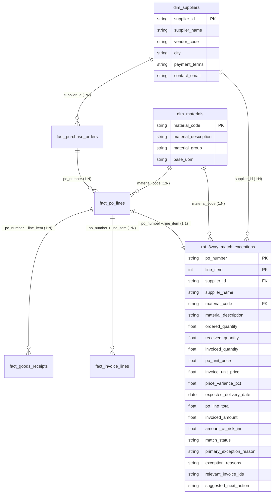

# Power BI Data Model Architecture — SAP Procurement 3-Way Match

## Power BI Relationship Configuration

| From Table (`*` Many) | Foreign Key | To Table (`1` One) | Primary Key | Cardinality | Cross Filter Direction | Active |
|---|---|---|---|---|---|---|
| `rpt_3way_match_exceptions` | `supplier_id` | `dim_suppliers` | `supplier_id` | Many to One (*:1) | Single (`dim_suppliers` filters Exceptions) | Yes |
| `rpt_3way_match_exceptions` | `material_code` | `dim_materials` | `material_code` | Many to One (*:1) | Single (`dim_materials` filters Exceptions) | Yes |
| `fact_purchase_orders` | `supplier_id` | `dim_suppliers` | `supplier_id` | Many to One (*:1) | Single (`dim_suppliers` filters Orders) | Yes |
| `fact_po_lines` | `po_number` | `fact_purchase_orders` | `po_number` | Many to One (*:1) | Single | Yes |
| `fact_po_lines` | `material_code` | `dim_materials` | `material_code` | Many to One (*:1) | Single | Yes |
| `fact_goods_receipts` | `po_number` | `fact_po_lines` | `po_number` | Many to One (*:1) | Single | No (Pre-aggregated in reporting table) |
| `fact_invoice_lines` | `po_number` | `fact_po_lines` | `po_number` | Many to One (*:1) | Single | No (Pre-aggregated in reporting table) |

> [!IMPORTANT]
> Notice that `fact_goods_receipts` and `fact_invoice_lines` are NOT joined directly to each other in Power BI. Joining them directly in the data model would re-introduce the fan-out / cartesian product trap. All multi-document aggregations are pre-resolved in the curated reporting table `rpt_3way_match_exceptions.csv`.
