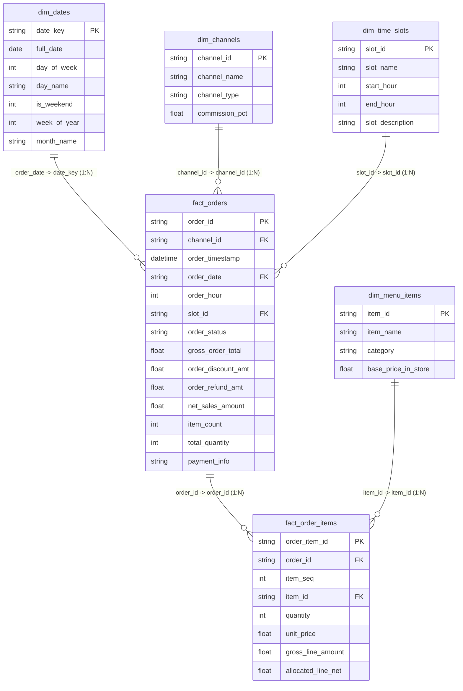

# Power BI Star Schema Data Model

## Relationship Configuration Matrix

| From Table (`*` Many) | Foreign Key | To Table (`1` One) | Primary Key | Cardinality | Cross Filter Direction | Active |
|---|---|---|---|---|---|---|
| `fact_orders` | `order_date` | `dim_dates` | `date_key` | Many to One (*:1) | Single (`dim_dates` filters `fact_orders`) | Yes |
| `fact_orders` | `channel_id` | `dim_channels` | `channel_id` | Many to One (*:1) | Single (`dim_channels` filters `fact_orders`) | Yes |
| `fact_orders` | `slot_id` | `dim_time_slots` | `slot_id` | Many to One (*:1) | Single (`dim_time_slots` filters `fact_orders`) | Yes |
| `fact_order_items` | `order_id` | `fact_orders` | `order_id` | Many to One (*:1) | Single (`fact_orders` filters `fact_order_items`) | Yes |
| `fact_order_items` | `item_id` | `dim_menu_items` | `item_id` | Many to One (*:1) | Single (`dim_menu_items` filters `fact_order_items`) | Yes |
